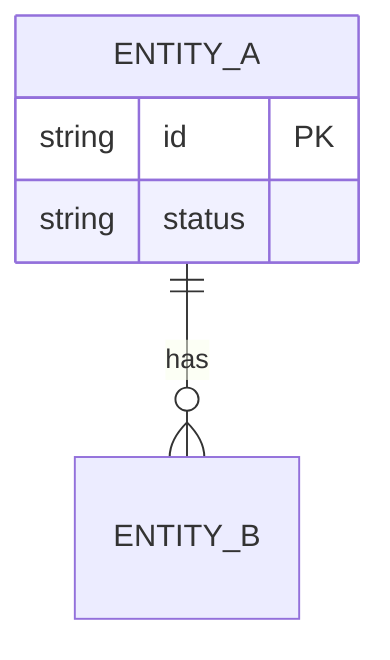

# <id>: L2 data and contracts

Before: <"n/a: new" or the prior diagram, same style.> After: above.

## Schema
<Pointer to the schema source of truth, `path/to/schema.ts:1`. Types are derived from it; do not restate fields here beyond what the diagram shows.>

## Contracts
| Contract | Producer | Consumer | Version | Fixture |
|---|---|---|---|---|
| <name> | <component> | <component> | v1 | tests/fixtures/<file> |

## Migration and back-compat
<Steps, reversibility, compat views. "None" if nothing migrates.>
