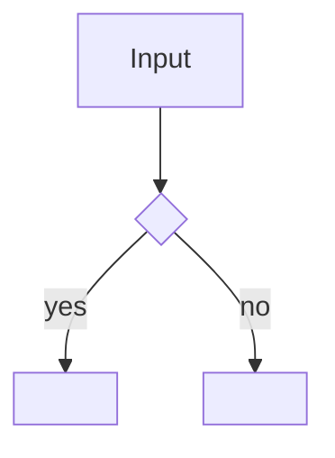

# <id>: L3 functional and acceptance criteria

## FR/NFR delta
| ID | Change | Note |
|---|---|---|
| FR-1 | added | <...> |
| NFR-1 | added | <...> |

## Acceptance criteria
| AC | Traces | Given / when | Pass when | Fail when | Test |
|---|---|---|---|---|---|
| AC-1 | CAP-1, FR-1 | <precondition and action> | <observable pass> | <observable fail> | tests/<file>.test.ts |
| AC-2 | CAP-2 | <...> | <...> | <...> | tests/<file>.test.ts::<node> |
| AC-3 | NFR-1 | <benchmark run> | <budget met> | <budget exceeded> | tests/bench/<file>.test.ts |

Tests cite `<id>/AC-<n>` verbatim (for example `<id>/AC-1`). Every CAP must appear in the Traces of at least one row.
