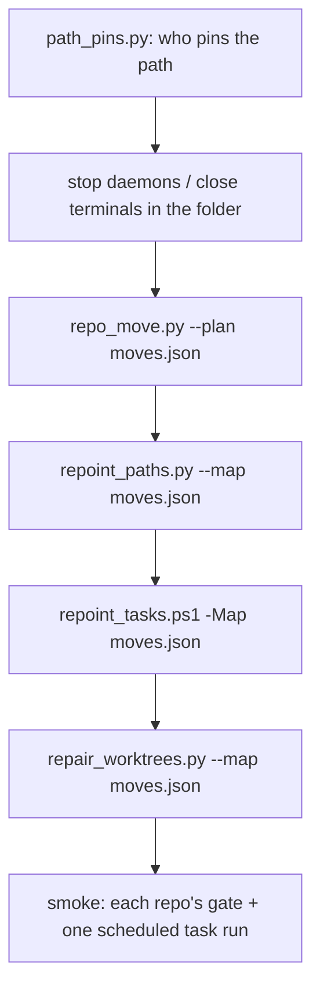

# /repo-move

1. Write `moves.json`: `[{"from": "web/x", "to": "SaaS/x", "why": "..."}]`. Targets follow the theme folders in the core CLAUDE.md. Order longest path first when a parent folder also moves.
2. `python ~/.claude/scripts/path_pins.py` and read the pins for each source.
3. Stop what holds the folder: daemons (e.g. `node core/cli.js stop` for Foreman), dev servers, terminals, and Claude sessions that read files there. An elevated process needs the owner (hand them the command).
4. Run, in this order, all four every time (never hand-pick steps):
   - `python ~/.claude/scripts/repo_move.py --plan moves.json` (renames folders and Claude history, writes MOVES.jsonl; `--undo` reverts the last batch)
   - `MSYS_NO_PATHCONV=1 python ~/.claude/scripts/repoint_paths.py --map moves.json --exclude /test/ --exclude /tests/ --exclude .test. --exclude .spec. --exclude /.claude/telemetry/` (dry-run first with `--dry-run`)
   - `powershell -NoProfile -File ~/.claude/scripts/repoint_tasks.ps1 -Map moves.json` (a task stored with a password needs the owner)
   - `python ~/.claude/scripts/repair_worktrees.py --map moves.json` (git worktree links and pnpm junctions)
5. Verify: every scheduled task's script path exists; run each moved repo's test gate; start one moved task and require `LastTaskResult` 0; restart any daemon you stopped from its new path.
6. Commit the rewritten files per repo (only files that were clean before), and update `D:/repo/_Archive/README.md` for archives.
