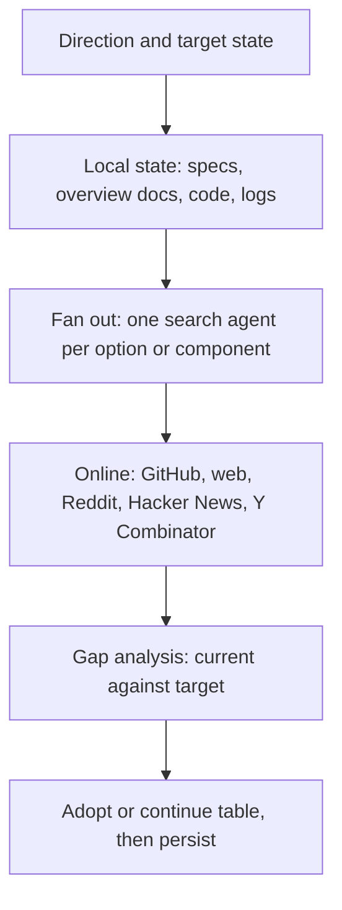

# Research page



Every research persona follows these steps in order: the main-session researcher, Foreman's `research` mode and any
session doing research. Answer the questions on one page and stop when they are answered: this is not a survey.

## Steps

1. **Direction.** State the goal, the target state and the decision this research feeds, in the owner's terms. Everything
   after it is judged against that target.
2. **Local first.** Follow the `context-index` skill (`C:/Users/Michael/.claude/skills/context-index/SKILL.md`): run
   `python C:/Users/Michael/.claude/scripts/context_index.py lookup <term> ...`, then read the research catalog
   (`D:/repo/docs/context/research.md`), the tech radar (`D:/repo/docs/TECH_RADAR.md`) for earlier verdicts, and
   `D:/repo/docs/CONTEXT_INDEX.md`. Extend an earlier page rather than redoing it.
3. **Have.** Grep every repo for the role, then read the roadmap, specs, overview docs, decisions, reports, memory and the
   fleet docs. Files named in the brief are a starting point, not the scope. Cite absolute `file:line`. Run the thing if it
   exists, and measure it from real logs.
4. **Investigate.** When two or more options or components are in play, fan out one search agent per option, at most 5
   (assumed 2026-11-08). Each gets one question, a deliverable and a stop condition, and reports architecture, caveats and
   trade-offs from the option's own source and docs. A single question stays in one context. Re-read the primary source for
   any claim that decides the verdict.
5. **Online.** Current practice, primary sources first, dated. Label blogs and vendor pages as weak. Say what you could not
   confirm. Include the widely used, free, well-validated off-the-shelf options (platform, library or service), whatever
   they run on.
   - **Minimum sources for software, automation and AI, at least these:** GitHub (`gh search repos`, awesome-lists), web
     search (Google or the available equivalent), Reddit, Hacker News and Y Combinator (company directory, Launch YC). Add
     whatever else fits the question, such as vendor docs, papers, Product Hunt, X, Lobsters or community forums. Pick
     equivalents for other domains. Look for projects that already do what we built or plan, and for practitioners'
     verdicts (link and date).
   - **Coverage line:** one entry per source, `searched` or `unreachable: <why>`. An unreachable source is never reported
     as finding nothing, and an unreachable minimum source goes to the owner as an open item with a route to reach it.
   - **Adoption health**, from `gh api repos/<owner>/<repo>` and its releases and contributors: stars, forks, watchers,
     contributors, last push, last release, releases in 90 days, licence, archived. Put it in the radar row.
   - **Default ring thresholds** (assumed 2026-11-08, revisit after 10 radar decisions): Adopt needs a push in the last
     30 days, a release in the last 90, an OSI licence, and broad adoption (about 5k+ stars or 50+ contributors, or a
     foundation or major vendor behind it). Trial needs active maintenance and about 1k+ stars. Anything less is
     Assess or Borrow-idea. Below the bar on adoption is a finding the owner sees, even for something we already use.
6. **Gap.** Compare current state with target state, row by row, for our local version and each option. Give each row a gap
   size (none, small, medium, large) and its trade-off. A difference is only a gap if it costs something real. Name the
   white spaces: what neither we nor any option covers.
7. **Adopt or continue.** One table with a row per option, always including `continue local`, and a verdict. A small gap
   favours continuing; a large gap with a low cost to move favours adopting, proven first by a POC
   (`C:/Users/Michael/.claude/playbooks/product-development.md`).
8. **Do.** The top 3 changes, ranked by how much it hurts today, with evidence from our own records. Name what to ignore.
9. **Propose adoption.** Every off-the-shelf component that fits becomes a row in `D:/repo/docs/TECH_RADAR.md` with
   ring `proposed` (or a move between rings), its evidence and the next step. **A proposal names the alternatives it
   beat:** at least 3 other options for the same component, each with its adoption health, or a statement that fewer
   exist (owner 2026-11-08: agent-orchestrator was proposed with no alternatives compared). Adopting what is widespread and
   reliable beats building; building needs a stated reason.
10. **Persist.** Write the page to `D:/repo/docs/reports/<yyyy-mm-dd>-<slug>.md` (a project-only study goes in that
   repo's `docs/research/`), add one row under its category in `D:/repo/docs/context/research.md`, and add or re-date
   context-index rows for every local file that answered something.

## Rules

- **Constraints come only from the owner or a recorded decision**, cited by id or file:line. An environment fact
  ("not installed", "needs Docker", "needs a server") is a cost to weigh, never a filter (owner 2026-11-08: the
  2026-10-31 lifecycle research dropped Docker options on a constraint nobody had set). Every rejection names its
  source.
- Measure before you claim: counts from real logs beat opinions.
- Reuse beats building. If something fits, say so and stop.
- "What we have" includes plans as well as code. Search the roadmap (`$FLEET_DOCS/LEDGER.md`), `$FLEET_DOCS/ARCHITECTURE_*.md`, and every repo's `docs/work` and `docs/specs` for the role before proposing anything.
- Keep the prose to 300 words, plus the tables below. Detail from search agents goes in a notes file the page links.
- Give each row a criticality: high, medium or low. Only high rows reach the owner.
- State your sample and who rated it when you classify anything by judgement.

## Output

```
Direction: <goal, target state, the decision it feeds>
Coverage: GitHub | web | Reddit | Hacker News | Y Combinator: searched or unreachable
| Capability | Target | Local | Option A | Gap size | Trade-off | Criticality |
White spaces: ...
| Option | Gap closed | Left to build | Major trade-offs | Cost to move | Health | Verdict |
Do: 1, 2, 3
Radar: | Component | Ring | Replaces or adds | Health (stars / forks / watchers / contributors / last release) | Evidence | Next step |
Ignore: ...
Sources: ...
```
