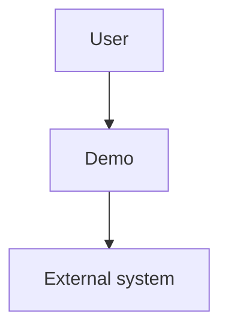

# Demo feature

## Purpose
Show a valid work item for the checker fixtures.

## Non-goals
- Anything beyond the fixtures.

## Capabilities
| CAP | Statement |
|---|---|
| CAP-1 | The user can run the demo |
| CAP-2 | The service must answer requests |
| CAP-3 | The service must not lose a request |
| CAP-4 | The service must answer fast |
| CAP-5 | The service must keep its boundary |

## Non-functional requirements
| NFR | Target | Method | Evidence |
|---|---|---|---|
| NFR-1 | p95 latency <= 200 ms | latency-bench: time the answer | AC-3 |
| NFR-2 | no import from core into plugins | fitness: import rule | AC-4 + config:rules/rules.cfg |

## Trade-offs
| Option | Latency | Cost | Maintenance | Extensibility | Refactorability | Verdict |
|---|---|---|---|---|---|---|
| Inline | low | low | medium | low | low | chosen |
| Queue | medium | medium | high | high | high | rejected: too heavy |

## Patterns applied
| Pattern | Where | Why |
|---|---|---|
| adapter | comp-b | isolates the external system |

## Components chosen
| Need | Chosen (off the shelf) | Rejected | Why rejected |
|---|---|---|---|
| parsing | PyYAML | hand-rolled parser | cannot read nested keys |

## Gate plan
| Risk | Kind (deterministic / qualitative) | Check | Blocking / advisory |
|---|---|---|---|
| wrong answer | deterministic | pytest | blocking |
