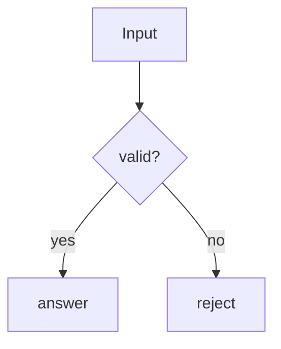

# demo: L3 functional

## FR/NFR delta
| ID | Change | Note |
|---|---|---|
| FR-1 | added | first |

## Acceptance criteria
| AC | Traces | Given / when | Pass when | Fail when | Test |
|---|---|---|---|---|---|
| AC-1 | CAP-1, FR-1 | user runs it | it answers | no answer | tests/demo_cases.txt |
| AC-2 | CAP-2, CAP-3, FR-2 | a request arrives | it is answered | it is lost | tests/demo_cases.txt::case |
| AC-3 | CAP-4, NFR-1 | benchmark runs | p95 within budget | over budget | tests/demo_cases.txt |
| AC-4 | CAP-5, NFR-2 | import rule runs | no violation | violation | tests/demo_cases.txt |
