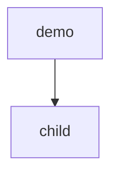

# Demo child

## References

### Local

| Source (file:line) | Status (working / partial / broken) | What it shows | Decision (extract / wrap / replace / ignore) + reason |
|---|---|---|---|
| docs/work/demo/README.md:1 | working | the parent item | extract: reuse it |

### Web

| Source (URL) | Date checked | What it shows | Decision |
|---|---|---|---|
| https://example.org/demo | 2026-10-31 | a convention | ignore: not relevant |

## Operating envelope

| Assumption | How it is observed (not hoped) | If violated |
|---|---|---|
| one user at a time | AC-1 | refuse: exit 1 with a named reason |

## Purpose
A nested part.

## Non-goals
- The parent's work.

## Capabilities
| CAP | Statement |
|---|---|
| CAP-1 | The service must expose the plug-in contract |

## Non-functional requirements
None.

## Gate plan
| Risk | Kind (deterministic / qualitative) | Check | Blocking / advisory |
|---|---|---|---|
| contract drift | deterministic | pytest | blocking |
