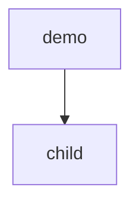

# Demo child

## Purpose
A nested part.

## Non-goals
- The parent's work.

## Capabilities
| CAP | Statement |
|---|---|
| CAP-1 | The service must expose the plug-in contract |

## Non-functional requirements
None.

## Gate plan
| Risk | Kind (deterministic / qualitative) | Check | Blocking / advisory |
|---|---|---|---|
| contract drift | deterministic | pytest | blocking |
