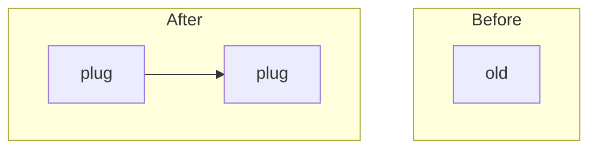

# demo-child: L2 components

## plug

### Interface
f(x)

### Functional requirements
| FR | Requirement |
|---|---|
| FR-1 | does 1 |

### Data
none

### Failure modes
| Failure | Detection | Handling |
|---|---|---|
| bad input | validation | reject |

### Budget
| Dimension | Budget |
|---|---|
| Latency | 10 ms p95 |
