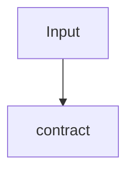

# demo-child: L3 functional

## FR/NFR delta
| ID | Change | Note |
|---|---|---|
| FR-1 | added | contract |

## Acceptance criteria
| AC | Traces | Given / when | Pass when | Fail when | Test |
|---|---|---|---|---|---|
| AC-1 | CAP-1, FR-1 | a plug-in calls it | contract holds | contract breaks | tests/demo_cases.txt |
